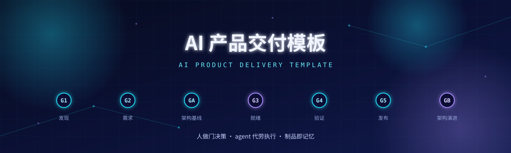
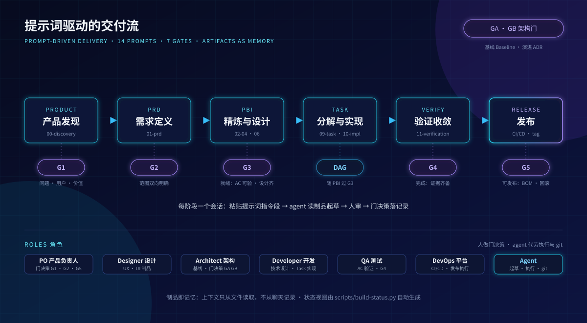

<div align="center">
  
</div>

# AI Product Delivery Template

一套**提示词驱动的 AI 产品交付操作系统**模板：把"从产品想法到发布"的全过程固化为制品（文档）+ 门（质量关卡）+ 提示词（会话协议），让团队中的每个角色在 agent 的辅助下做好自己的工作、交付自己的成果。

- **与产品无关**：互联网产品、内部工具、平台服务均可套用
- **与 agent 无关**：任何能读写文件、执行命令的编码 agent 均可接入
- **与方法论解耦**：通用交付内核之上，Scrum 只是一种可选的交付方式

## 它解决什么问题

| 痛点 | 本模板的做法 |
| --- | --- |
| agent 会话越长越失忆，换个窗口就重来 | **制品即记忆**：上下文只从文件读取，不从聊天记录恢复 |
| AI 写代码快，但质量没人把关 | **7 道门（G1-G5/GA/GB）**：每道门有明确判据，人做决策，agent 代劳记录 |
| 需求、设计、代码、验证对不上 | **全程可追溯**：Task → PBI → 验收标准 → 验证证据 → 发布 BOM |
| 流程靠口头约定，新人上手靠猜 | **14 个提示词**即会话协议：一个提示词启动一个阶段，输入输出写死在文件里 |

## 使用方式

<div align="center">
  
</div>

### 快速开始

1. **拷贝模板**到自己的产品仓库，提交基线
2. **填写** [PROJECT-PROFILE.yaml](PROJECT-PROFILE.yaml)：产品名、交付方式、agent 类型
3. **选择交付方式**：通用迭代（默认）或 Scrum（启用 `.agent/scrum/`）
4. **启动发现**：把 [.agent/prompts/00-discovery.md](.agent/prompts/00-discovery.md) 作为系统提示词开新会话
5. 之后每个阶段：**人带门决策 → agent 按提示词起草 → 门记录落盘 → 进入下一阶段**

### 核心概念

| 概念 | 说明 | 位置 |
| --- | --- | --- |
| 门（Gate） | 质量关卡：G1 发现 / G2 需求 / GA 架构基线 / G3 就绪 / G4 验证 / G5 发布 / GB 架构演进 | [.agent/gates/gates.yaml](.agent/gates/gates.yaml) |
| 门记录 | 每次门决策的留痕：判据勾选、决策人、返工去向 | `docs/delivery/gates/` |
| 提示词 | 14 个阶段会话协议，一个提示词 = 一个会话 | [.agent/prompts/](.agent/prompts/) |
| 制品 | 项目记忆的唯一载体：PRD、PBI、Task、基线、门记录 | [docs/](docs/) |
| 角色 | PO / Designer / Architect / Developer / QA / DevOps + Agent | [.agent/roles/role-catalog.md](.agent/roles/role-catalog.md) |

## 仓库结构

```
.agent/            模板域：门定义、提示词、角色、技能、制品模板（实例不改动）
  gates/           7 门判据定义
  prompts/         14 个阶段提示词（00 发现 → 13 回顾）
  roles/           角色目录与 A/R/C 矩阵
  scrum/           Scrum 交付方式（可选启用）
  skills/          agent 技能（验收标准写作、Task 分解、验证证据收集）
  templates/       制品模板（PBI、Task、门记录、ADR、检查点等）
docs/              产品实例域：你的产品制品都长在这里
  discovery/       发现与研究
  product/         产品简介、PRD、路线图
  features/        Feature / PBI / Task
  architecture/    架构基线、ADR、技术设计
  delivery/        门记录、状态视图、发布、检查点
scripts/           build-status.py：由制品自动生成状态视图
assets/            README 演示图
AGENTS.md          canonical 协议：agent 行为准则（所有 agent 先读它）
OPERATING-GUIDE.md 操作手册：怎么启动产品、怎么过门、怎么发布
EXAMPLE.md         端到端走查：MiniTodo 案例 10 天从发现到发布（含 Git 规范）
PROJECT-PROFILE.yaml 实例配置入口
TEMPLATE-VERSION   模板版本号
```

## 深入阅读

| 文档 | 什么时候读 |
| --- | --- |
| [AGENTS.md](AGENTS.md) | 所有 agent 开工前必读：行为准则、上下文纪律、可追溯性、Git 约定 |
| [OPERATING-GUIDE.md](OPERATING-GUIDE.md) | 团队上手：启动产品、过门流程、发布流程、目录所有权 |
| [EXAMPLE.md](EXAMPLE.md) | 想看完整长什么样：3 人团队 + agent 用 10 天交付 MiniTodo 的全程实录 |
| [.agent/prompts/](.agent/prompts/) | 开工时：当前阶段对应的提示词即本会话协议 |

## 模板升级

`.agent/` 与根级协议文件属于模板域，由模板版本统一演进；`docs/`、`PROJECT-PROFILE.yaml`、`.agent/local/` 属于产品实例，模板升级永不覆盖。升级流程见 [OPERATING-GUIDE.md](OPERATING-GUIDE.md) 的"模板升级"章节。
